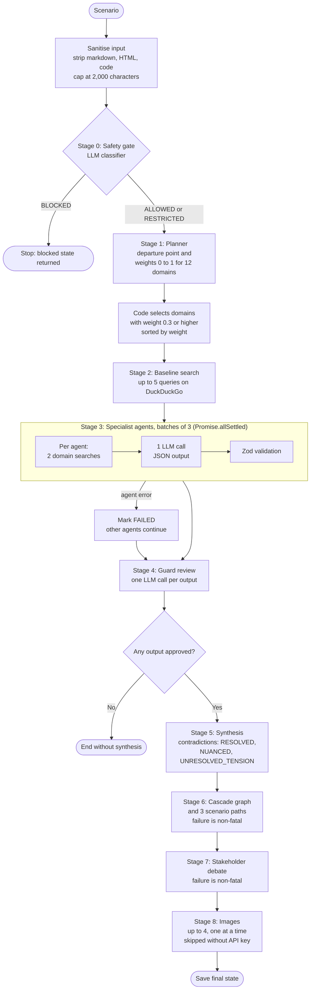
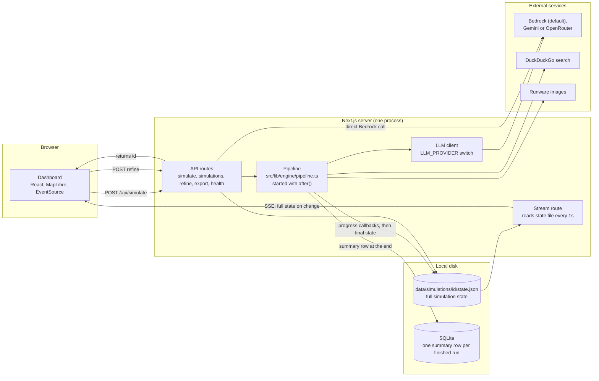

# Counterfact

> *Simulate what history never built.*

Counterfact takes a "What If" scenario and produces a structured report on it. Instead of asking one model for an answer, it plans the research, runs a set of domain specialist agents (historian, economist, military analyst and so on), reviews their outputs, merges them into one analysis, and then models second and third order effects. A Next.js dashboard shows the result with a globe map.

The scenarios are mostly geopolitical ("What if the Berlin Wall never fell?"), but the safety classifier accepts any speculative or alternate-history question.

## Screenshots


## How a simulation runs

The pipeline lives in `src/lib/engine/pipeline.ts`. This flowchart shows the real order of execution, including where a run can stop early.



These are the stages, in the order they execute.

| Stage | What happens |
|---|---|
| Input cleanup | The scenario is stripped of markdown, HTML and code blocks and capped at 2,000 characters (`src/lib/safety/sanitize.ts`). |
| 0. Safety gate | One LLM call classifies the scenario as `ALLOWED`, `RESTRICTED` (runs with disclaimers) or `BLOCKED` (stops here). |
| 1. Planner | One LLM call returns a departure point and a relevance weight from 0 to 1 for each of the 12 domains. The code then picks every domain with weight 0.3 or higher, highest weight first. The number of agents depends on the weights the model returns, so it varies by scenario and can reach 12. |
| 2. Baseline fetch | Up to 5 planner-suggested queries are run on DuckDuckGo (4 results each) to give the agents real-world facts. |
| 3. Specialist agents | Agents run in batches of 3 with `Promise.allSettled`. Each one runs two domain-specific searches, then makes a single LLM call with the scenario, departure point, search results and a domain prompt. The reply must be JSON and is validated with Zod. If an agent fails, it is marked `FAILED` and the run continues with the others. |
| 4. Guard review | One LLM call per agent output checks for prompt-injection signs, missing citations, inflated confidence and unsafe content. An output the guard rejects is left out of synthesis. If the guard call itself errors, the output passes by default. If nothing survives, the run ends without a synthesis. |
| 5. Synthesis | One LLM call merges the approved outputs into a single analysis and records each contradiction as `RESOLVED`, `NUANCED` or `UNRESOLVED_TENSION`. |
| 6. Cascade | One LLM call builds a graph of second and third order effects (nodes and edges, each with a 0 to 1 confidence), lists feedback loops, and writes three scenario paths: optimistic, base case and pessimistic. Failure here does not stop the run. |
| 7. Stakeholder debate | One LLM call writes positions for the main stakeholders. Failure here does not stop the run. |
| 8. Images | Up to 4 images are generated one after another with Runware. Skipped if no `RUNWARE_API_KEY` is set. |

Things worth knowing about how this works:

- **Search is fetched by the code, not requested by the model.** Agents do not call a search tool on their own. The code runs the searches first and puts the results in the prompt.
- **Search is rate limited.** All DuckDuckGo requests go through one queue with a 2 second gap, so searches from different agents run one at a time even though the LLM calls in a batch run concurrently.
- **Model output is parsed defensively.** JSON is pulled out of code fences or the first `{...}` block, then checked against the Zod schemas in `src/lib/engine/types.ts`. Some schemas accept sloppy output on purpose, for example confidence labels like `LOW` or `MEDIUM` are mapped to `SPECULATIVE`, and visual prompts may be plain strings.
- **Retries cover rate limits only.** Bedrock throttling errors are retried with exponential backoff (2s, 4s, up to 3 attempts). A reply that is not valid JSON, or fails the schema, is not retried and fails that step.
- **Confidence scores are the model's own estimates.** The `HIGH` / `MODERATE` / `SPECULATIVE` labels and the 0 to 1 edge scores come from the model. They are not calibrated probabilities.

## System architecture

Everything runs in one Next.js server process. The browser never talks to the pipeline directly. It starts a run through an API route and then watches the saved state file through the stream endpoint.



The safety classifier and the `/refine` route call Bedrock directly instead of going through the LLM client, which is why the last arrow bypasses it.

## Live updates

`POST /api/simulate` saves an initial state file, starts the pipeline with Next.js `after()`, and returns `{ id }` immediately.

While the pipeline runs, callbacks update the state file for the safety check, the planner result, and each agent starting, finishing or failing. The synthesis, cascade, stakeholder and image results are written when the whole run finishes.

`GET /api/simulations/:id/stream` is a Server-Sent Events endpoint. It reads the state file once per second, sends the full state whenever `updatedAt` changes, and closes the stream when a synthesis exists or the scenario was blocked. The dashboard listens with `EventSource`.

## LLM providers

All agents go through `src/lib/llm/llm-client.ts`, which picks a provider from `LLM_PROVIDER`:

| `LLM_PROVIDER` | Backend |
|---|---|
| `bedrock` (default) | AWS Bedrock. Handles both the Anthropic message format and OpenAI-style models. The default model ID is `zai.glm-5`. Set `BEDROCK_MODEL_ID` to use another model, for example a Claude model. |
| `gemini` | Google Gemini (`GEMINI_API_KEY`, optional `GEMINI_MODEL_ID`). |
| `openrouter` | OpenRouter through the OpenAI SDK (`OPENROUTER_API_KEY`, optional `OPENROUTER_MODEL_ID`). |

Two code paths still call Bedrock directly and ignore `LLM_PROVIDER`: the safety classifier and the `/refine` endpoint.

## Tech stack

**Backend:** Next.js 16 (App Router), TypeScript, Zod 4, AWS SDK for Bedrock Runtime, `@google/generative-ai`, `openai` (for OpenRouter), `better-sqlite3`, `@navetacandra/ddg` for DuckDuckGo search, Runware (REST) for images.

**Frontend:** React 19, HeroUI, Tailwind CSS 4, Framer Motion, MapLibre GL (CartoDB Dark Matter style, globe projection, heatmap and arc layers, pulse markers), `react-markdown`.

**Testing:** Vitest.

## Storage

- Full simulation state is a JSON file at `data/simulations/<id>/state.json`.
- A SQLite table stores a summary row per finished simulation (scenario, status, agent count, cost, timestamps). The default path is `/tmp/counterfact/counterfact.db` on Linux and macOS and `%LOCALAPPDATA%/counterfact/counterfact.db` on Windows. Set `DB_PATH` to change it.

Both live on local disk, so the app is built to run as a single server process.

## Getting started

Requirements: Node.js 20 or newer. For the default setup, an AWS account with Bedrock model access in your region. Alternatively, a Gemini or OpenRouter key.

```bash
git clone https://github.com/DineshKumarCLG/CounterFact.git
cd CounterFact
npm install --legacy-peer-deps
```

Create `.env.local` (there is no `.env.example` in the repo yet):

```env
# Default provider: AWS Bedrock (credentials also work from ~/.aws or an IAM role)
AWS_ACCESS_KEY_ID=your-access-key-id
AWS_SECRET_ACCESS_KEY=your-secret-access-key
AWS_REGION=ap-south-1
BEDROCK_MODEL_ID=your-bedrock-model-id

# Or use another provider
# LLM_PROVIDER=gemini
# GEMINI_API_KEY=...
# LLM_PROVIDER=openrouter
# OPENROUTER_API_KEY=...

# Optional: image generation
RUNWARE_API_KEY=your-runware-api-key
```

Run the app:

```bash
npm run dev
```

Open http://localhost:3000, type a scenario, and watch the agents run.

You can also run a simulation from the terminal. The CLI reads a `.env` file (not `.env.local`):

```bash
npx tsx src/cli/simulate.ts "What if Tamil Nadu was a separate country?"
```

## Dashboard

The report has seven tabs: Synthesis, Domains, Contradictions, Cascades, Paths, Stakeholders and Ask. The map beside it shows cascade impact as a heatmap, arcs between affected regions, and pulse markers on the countries involved. It does not draw political borders, so scenarios with redrawn borders still render correctly.

The Ask tab sends follow-up questions to `/refine`, which answers from the saved analysis and keeps the conversation in the state file.

## API

| Method and path | What it does |
|---|---|
| `POST /api/simulate` | Body `{ "scenario": "..." }`. Starts a run and returns `{ "id": "..." }`. |
| `GET /api/simulations` | Lists finished simulations from SQLite. Query params `limit` (max 100) and `offset`. |
| `GET /api/simulations/:id` | Returns the full state. |
| `DELETE /api/simulations/:id` | Deletes the saved state directory for that simulation. |
| `GET /api/simulations/:id/stream` | Server-Sent Events stream of the full state, as described above. |
| `POST /api/simulations/:id/refine` | Body `{ "question": "..." }`. Returns `{ "answer", "inputTokens", "outputTokens" }`. Not streamed. |
| `GET /api/simulations/:id/export?format=json` or `format=markdown` | Downloads the simulation. |
| `GET /api/health` | Returns the prompt version and the configured Bedrock model ID. |

## Prompts

Agent prompts are Markdown files in `src/lib/prompts/v1.0/`, one per agent. They are loaded and cached by `prompt-loader.ts`, and each saved simulation records the prompt version it used. If a specialist's prompt file is missing, a generic prompt is built from the domain name.

## Cost tracking

Every LLM call adds its token counts to `costTracking` in the saved state. The dollar figure is computed with fixed Claude Sonnet 4 rates ($3 per million input tokens, $15 per million output tokens) no matter which model is configured, so treat it as an estimate unless you run a model with those prices.

## Tests

```bash
npm test
```

There are 26 Vitest tests in 4 files, covering the Zod schemas, input sanitisation, domain selection and the cost calculation. The pipeline and the LLM calls are not tested yet.

## Known limitations

- Runs as one local server process. State is on local disk and the pipeline runs inside the web server, so it is not set up for serverless hosting.
- No authentication or per-user data.
- Output quality is not evaluated automatically. The guard agent and the self-critique fields in agent output are LLM judgments.
- The guard review, cascade, stakeholder and image steps run one after another, not in parallel.
- `LLM_PROVIDER` does not apply to the safety classifier or `/refine` (see above).

## Design documents

`COUNTERFACT_PDR_v1.0.md` and `COUNTERFACT_PDR_v2.0.md` are product design documents. They describe the intended production system (queues, managed databases, authentication, billing tiers), which is larger than what is built here. This README describes the code as it exists.

## Roadmap

- [ ] PDF export (currently JSON and Markdown only)
- [ ] User accounts and a saved simulation library
- [ ] Public sharing of simulations
- [ ] Selectable analysis depth (quick, standard, deep)
- [ ] Custom nation map with redrawn borders (D3 and GeoJSON)
- [ ] Timeline scroll view
- [ ] Tests for the pipeline with mocked LLM responses

## Built by

Dinesh Kumar, Chennai, India
